Computer Engineering student @ uOttawa. Embedded Firmware Developer on uORocketry's beamforming team (STM32, CAN, SPI).

**Projects**
- [AXI4-Lite to SPI Bridge](https://github.com/AdamTarkhani/axi4lite-to-spi-bridge): SystemVerilog, verified with cocotb
- [STM32 FreeRTOS Warehouse Monitor](https://github.com/AdamTarkhani/Stm32-freertos-warehouse-monitor-): FreeRTOS tasks, semaphore, queue and mutex on a Nucleo-F446RE
- [UART Transmitter](https://github.com/AdamTarkhani/Uart-Transmitter): SystemVerilog, verified with cocotb

[LinkedIn](https://www.linkedin.com/in/adam-tarkhani/) · adam.tarkhani55@gmail.com
